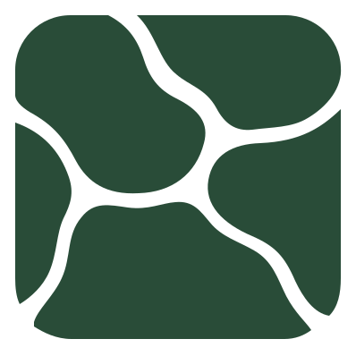

# Mossbed marks

Copyright 2026 zbrdc. Licensed under [Apache-2.0](../LICENSE).

## Moss tile: compact icon

`icon.svg` is the vector source for application icons. `icon.png` is 512 × 512,
and `favicon.png` is 32 × 32. Use at least 24px where possible.
At 16px, the silhouette remains visible but the winding channels compress.

## Sheltered tardigrade: mascot

`logo.svg` is the vector source for the README mascot. `logo.png` is 512 × 313.
Use at least 144px wide for the eye and four feet. Small claws read best at
256px or larger.

## Usage

Both marks use literal moss green `#294C38`. Backgrounds, channels, and eye
space are transparent. Use a light background. This green has low contrast
on dark surfaces.

Edit the SVG sources, then regenerate the PNG exports. Keep the transparent
padding so the marks do not clip. The SVGs have accessible titles for standalone
use. Supply appropriate alt text when embedding them as images.

No alternate palettes or wordmarks are included.

